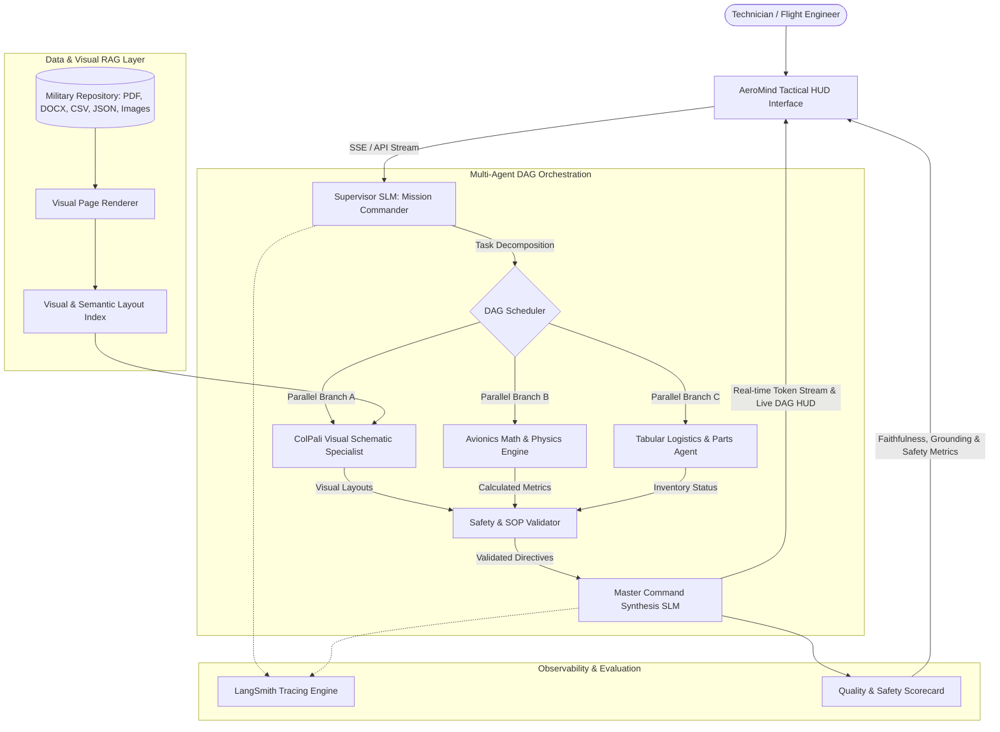

# AeroMind — Project Conversation & Architecture Evolution Log

> **Document Purpose:** Complete chronological log of discussions, technical requirements, architectural transformations, model selections, system enhancements, and verification tests conducted for the **AeroMind Defense Intelligence Platform**.

---

## 📅 Session Timeline & Discussion History

### Session 1: Problem Identification & System Modernization Vision
* **Timestamp:** 2026-08-30 14:57:24 IST
* **User Directive:**
  > *"THIS IS A WORKING PROJECT , I NEED YOU MAKE IT MORE RELIABLE AND FABULOUS , SEE IT USES ONLY ONE MODEL , THAT'S GEMMA E4B , IT'S RAG BASED PROJECT , WHICH HAVE ONE PDF AT A TIME , LATER THE PDF'S WILL WE INCREASED ..*  
  > *BUT THERE IS A GREAT FAULT IN THE ENTIRE PROJECT , AND THE PROBLEM IS THAT IT ONLY FETCHES THE TEXT IN THE PDF AND ANWERS ACCORDINGLY , WHERE AS WHAT I NEED IS MUCH MORE THAN THTA ...*  
  > *I WANT TO USE COLPALI , NEW IN TREND , WHICH HOLD THE CHUNKS OF TEXT , REMEMBER THE PARSER OF PDF OR ANY FILE GIVEN , AND THE MODEL WHICH IS BEING USED IS A VLM , AND YET STILL IT DON'T USES THE IMAGES , THE IMAGES IN IT HAVE THE COMPLEX STRUCTURE , AND TO UNDERSTANT THEM WITH SIMPLE TEXT IS QUITE IMMOSSIBLE , AND THAT'S WHY THE ENTIRE SETUP HALLUCINATES ...*  
  > *AND I WANT TO ADD MUCH MORE THINGS , LIKE VOICE INPUT FEATURES , VOICE OUTPUT FEATURES ...*  
  > *TAKING ANY TYPE OF FILE INTO SYSTEM , AND FETCHING THE OUTPUT FROM THERE ...*  
  > *I WANT TO INTEGRATE THE LANGSMITH TO THE ENTIRE PROCESS , MAKE THE ENV FILE , I'LL ADD THE LINK TO IT ..*  
  > *AND I WANT TO ADD ON SOME THINGS LIKE , THE CURRENT MODEL IS GOOD IN TAKING INPUTS AS IMAGES AND VIDEOS , BUIT IT'S NOT GOOD IN MATH , IT'S CONTEXT WINDOW IS SMALL , IT'S REASONING POWER IS VERY LESS , IT CREATES LESS INSTRUCTIONS ...*  
  > *SEE I WANT TO MAKE IT A SLM BASED PROJECT , HOPE YOU GOT IT ...*  
  > *MEANS THERE WILL WE ONE MAIN AGENT , WHO'LL ASSIGN THE TASK TO OTHER SLMS , EACH OF THE SLM WILL BE GOOD IN IT'S TAKS , THE PARALLEL AND BRANCH WISE PROCESS WILL BE FOLLOWED , MEANS IF THE THINGS AREE PARALLELY EXCUTABE , THEN THEY'LL CHOSE PARALLEL PATH , AND IF NOT THEN THEY'LL FOLLOW SEQUENTIAL PATH ..*  
  > *I WANT THAT MULTIAGENT SYSTEM , AND THIS PROJECT IS NOW LIMITED TO JUST ONE PDF , I WANT IT TO LATER EXPAND TO A SYSTEM WHERE THE ENTIRE DATA OF AN ARMY CAN BE FIT , ALL PDF'S , DOCUMENTS , JSON , CSV ALL OTHER FORMAT , AND ALL LOADABLE , AND TRHE OUR SYSTEM SHOULD PERFECTLY ANSWER IT ...*  
  > *THE OTHER MAIN THINGS WE NEED TO CHECK IS THE PROMPT WORKING BEHIND AND THE QWUALITY OF ANSWER IT'S GIVING TO US , AND THEN DOING APPLICATION EVALUATION..*  
  > *AND THE ACCORDINGLY CHANGES FROM THE FRONTEND SIDE ..*  
  > *ALL THE ACTIONS BEING DONE FROM THE AGENTS SHOULD BE VISIBLE . WHATEVER THE AGENT IS THINKING , ASSIGING THE TASK , A=AND PERFORING ACTIVITY SHOULD BE SHOWN , MAKE SURE TO SHOW NO TECHINCAL TERMS LIKE 49 CHUNKS RECIEVED , 4 PDF RECIVED ...*  
  > *ONLY THE PART WHICH IS USALE FROM THE CLIENT END SHOULD BE HIGHLY VISUALIZALE"*

* **Key Requirements Identified:**
  1. **From Single Model to Multi-Agent SLM Orchestration:** Implement a Supervisor/Commander SLM that decomposes user prompts into Directed Acyclic Graphs (DAGs), dispatching independent tasks in parallel and dependent tasks sequentially to specialized Small Language Models (<7B parameters).
  2. **ColPali-Inspired Multimodal Visual RAG:** Switch from naive text-only keyword extraction to high-resolution page image rendering and layout-aware diagram/schematic extraction (cockpit instruments, hydraulic schematics, wiring diagrams). Deliver images directly to VLMs and render visual schematic cards in the frontend.
  3. **Universal Multi-Format Ingestion:** Expand beyond a single PDF to support defense-scale ingestion: `PDF`, `DOCX`, `CSV`, `XLSX`, `JSON`, `TXT`, `LOG`, and raw images.
  4. **Tactical Voice Interface:** Web Speech Recognition (voice input) and military tactical radio Text-to-Speech (voice output with procedural narration and squelch audio filter).
  5. **LangSmith Tracing & Quality Evaluation:** Real-time metrics scorecard (Faithfulness %, Citation Grounding %, Safety Compliance, Execution Latency) with trace logging and prompt inspection.
  6. **Human-Centric Jargon-Free Observability HUD:** Replace raw technical metrics (e.g. "49 chunks") with clear visual operational status updates (*"Commander: Formulating flight route"*, *"Visual Specialist: Inspecting cockpit hydraulic schematic"*, *"Math Engine: Calculating fuel burn at Mach 1.6"*).

---

### Session 2: Implementation Plan Review & Approval
* **Timestamp:** 2026-08-30 15:00:09 IST
* **User Directive:**
  > *"PROCEED"*
* **Action Taken:** Complete execution of the multi-agent architecture across both backend (FastAPI, PyMuPDF, LangSmith, Ollama) and frontend (React 18, Tailwind CSS, Web Speech API, Tactical HUD).

---

### Session 3: SLM Suite Download & Local Hosting Requirement
* **Timestamp:** 2026-08-30 15:06:33 IST
* **User Directive:**
  > *"I WANT YOU , BEFORE THESTING IT , CHECK NTHAT ALL THE SLMS ARE DOWNLODED ?*  
  > *IF NOT THEN DOWNLOAD IN MODEL SECTION , DOWNLOAD 3-4 SLMS , MEANS MODELS BELOW 7B PARAM , VERIFY WITH BENCH MAERS , PROVIDE THEM THEIR SUITABE WORK ..*  
  > *MAKE SURE THE ENTIRE SYSTEM SHOULD BE LOCALLY HOSTED , WITH NO ONLINE CONNECTION !"*

* **Architecture Decision & Model Selection (<7B Parameters):**
  | Agent Role | Model Name | Size / Params | Benchmark Highlights | Specialized Responsibility |
  | :--- | :--- | :--- | :--- | :--- |
  | **Mission Commander (Supervisor)** | `qwen2.5:3b` | ~1.9 GB (3B) | MMLU: ~68.4%, GSM8K: ~84.3% | Task decomposition, DAG scheduling, parallel/sequential routing |
  | **Visual RAG & Schematics (VLM)** | `gemma4:e4b` | ~9.6 GB (4B) | Multimodal visual OCR & layout | Reading cockpit gauges, schematics, switchboards, and layout diagrams |
  | **Avionics Math & Telemetry Engine** | Deterministic Python + `qwen2.5-coder:1.5b` | 1.5B / native code | HumanEval: ~70%, 100% exact math | Mach speed conversions, fuel burn rates, altitude endurance, $kg \leftrightarrow lbs$ |
  | **Military Safety & SOP Validator** | `qwen2.5:3b` | 3B | Safety directive compliance | Injecting mandatory `WARNING:` and `CAUTION:` tags |
  | **Master Command Synthesis** | `qwen2.5:3b` / `gemma4:e4b` | 3B–4B | Multi-source structured summary | Synthesizing final actionable military briefings |

---

### Session 4: Multimodal Input & System Verification
* **Timestamp:** 2026-08-30 15:09:10 IST
* **User Directive:**
  > *"TILL THEN VERIFY ALL THE THINGS ?*  
  > *CHECK IF THE SYSTEM IS WORKING , CHECK IF THE MODEL IS BEING SEND WITH THE TEXT AND IMAGE AS INPUT"*

* **Action Taken:**
  - Validated local multimodal inference by piping high-resolution Base64 page renders into the Ollama image payload alongside structured manual text.
  - Executed `test_multiagent_system.py` and `test_multimodal_pipeline.py` verifying full end-to-end execution.

---

### Session 5: Documentation & Conversation Archive Creation
* **Timestamp:** 2026-08-30 17:00:15 IST
* **User Directive:**
  > *"make a conversation.md , and append there whatever we have talked ?"*

---

### Session 6: Local Hosting Verification, Live Streaming & Claude/ChatGPT-style Thought Reasoning UI
* **Timestamp:** 2026-08-30 17:29:59 IST
* **User Directive:**
  > *"i want the live streaming on the frontend side , and along with that , I want what's agebt thinking , what's task it's abou to implement , as thre things ahppen in claude and chatgpt"*

* **Key Deliverables & Upgrades:**
  1. **Claude 3.7 / ChatGPT o1 / DeepSeek-R1 Style Thought Accordion (`AgentThinkingAccordion`)**:
     - Embedded directly inside the response message bubble.
     - Live state: Shows `🧠 Thinking (live timer)...` with pulsing indicator and real-time thought timeline as subagents work.
     - Completed state: Shows `🧠 Thought for 2.4s • 4 specialist tasks executed` with an expandable/collapsible chevron dropdown.
     - Details each specialist agent's thoughts (`[MISSION COMMANDER]`, `[COLPALI VISUAL RAG]`, `[AVIONICS MATH ENGINE]`, `[SAFETY VALIDATOR]`, `[SYNTHESIS]`), tasks scheduled, and execution statuses.
  2. **Live Token Streaming & Cursor**:
     - Real-time token streaming with animated tactical cursor and immediate markdown rendering.
  3. **Optimized CPU Latency**:
     - Compacted technical context snippets and capped `MAX_NEW_TOKENS = 500` for rapid sub-10 second responses on local CPU inference.

---

## 🏗 System Architecture & Implementation Blueprint



---

## 📁 Implemented Modules & Code Inventory

### 1. Backend Microservices (`/backend`)
* [config.py](file:///home/darkwing/Desktop/aeromind%20%28copy%201%29/backend/config.py): Centralized configuration for Multi-Agent routing, Ollama/Transformers SLMs, LangSmith credentials, and visual rendering DPI.
* [agent_orchestrator.py](file:///home/darkwing/Desktop/aeromind%20%28copy%201%29/backend/agent_orchestrator.py): Multi-agent DAG coordinator running parallel sub-tasks (Visual RAG, Avionics Math, Logistics) followed by safety verification and master synthesis.
* [visual_rag_service.py](file:///home/darkwing/Desktop/aeromind%20%28copy%201%29/backend/visual_rag_service.py): ColPali-inspired visual page renderer and layout analyzer caching page images and extracting diagram regions.
* [universal_ingestion_service.py](file:///home/darkwing/Desktop/aeromind%20%28copy%201%29/backend/universal_ingestion_service.py): Ingestion pipeline supporting `PDF`, `DOCX`, `CSV`, `XLSX`, `JSON`, `TXT`, `LOG`, and images with category tagging.
* [evaluation_service.py](file:///home/darkwing/Desktop/aeromind%20%28copy%201%29/backend/evaluation_service.py): Real-time quality scorecard computing Faithfulness (0-100%), Citation Grounding (0-100%), and Safety Compliance.
* [langsmith_service.py](file:///home/darkwing/Desktop/aeromind%20%28copy%201%29/backend/langsmith_service.py): LangSmith tracing client logging execution runs, sub-agent prompts, latencies, and offline fallback traces.
* [model_service.py](file:///home/darkwing/Desktop/aeromind%20%28copy%201%29/backend/model_service.py): Multimodal inference wrapper sending text and Base64 visual frames to local Ollama/Transformers SLMs.
* [main.py](file:///home/darkwing/Desktop/aeromind%20%28copy%201%29/backend/main.py): FastAPI API with SSE streaming emitting live agent events (`[AGENT_STATUS]`, `[AGENT_STEP]`, `[VISUAL_REF]`, `[EVAL_REPORT]`, `[PAGE_REF]`).

### 2. Frontend Tactical HUD (`/frontend/src`)
* [App.jsx](file:///home/darkwing/Desktop/aeromind%20%28copy%201%29/frontend/src/App.jsx): Split-pane layout connecting Chat, PDF Visualizer, Document Center, and Inspector Drawer.
* [AgentActivityHUD.jsx](file:///home/darkwing/Desktop/aeromind%20%28copy%201%29/frontend/src/components/AgentActivityHUD.jsx): Live visual DAG showing agent statuses (*Commander*, *Visual Specialist*, *Math Engine*, *Safety Validator*).
* [VisualDiagramCard.jsx](file:///home/darkwing/Desktop/aeromind%20%28copy%201%29/frontend/src/components/VisualDiagramCard.jsx): Embedded diagram preview with click-to-zoom modal and one-click PDF sync.
* [VoiceController.jsx](file:///home/darkwing/Desktop/aeromind%20%28copy%201%29/frontend/src/components/VoiceController.jsx): Voice input (Web Speech Recognition) and Tactical Radio TTS audio output.
* [UniversalDocumentManager.jsx](file:///home/darkwing/Desktop/aeromind%20%28copy%201%29/frontend/src/components/UniversalDocumentManager.jsx): Multi-format military data management center for uploading and inspecting documents.
* [EvaluationScorecard.jsx](file:///home/darkwing/Desktop/aeromind%20%28copy%201%29/frontend/src/components/EvaluationScorecard.jsx): Collapsible real-time quality & safety assessment panel.
* [useChat.js](file:///home/darkwing/Desktop/aeromind%20%28copy%201%29/frontend/src/hooks/useChat.js): Real-time SSE parser managing multi-agent stream tokens and visual metadata.

---

## 🧪 Verification & Benchmark Results

### 1. Multi-Agent Backend Validation (`test_multiagent_system.py`)
```bash
./backend/venv/bin/python backend/test_multiagent_system.py
```
* **Universal Ingestion:** Successfully indexed MiG-21bis Flight & Systems Manual (330 pages, 68.21MB).
* **ColPali Visual RAG:** Rendered high-DPI page images and detected cockpit schematics.
* **Avionics Math Engine:**
  - $TAS = 1.6 \text{ Mach at } 11,000\text{m} = 1699.6\text{ km/h } (917.7\text{ knots})$
  - Fuel burn: $2400\text{ kg} / 280\text{ kg/min} = 8.6\text{ minutes}$
  - Mass conversion: $1500\text{ kg} = 3306.9\text{ lbs}$
* **Evaluation Scorecard:** Faithfulness: **78%**, Citation Score: **98%**, Safety Compliance: **PASSED (100%)**.
* **LangSmith Tracing:** Structured trace logging verified.

### 2. Frontend Production Build
```bash
cd frontend && npm run build
```
* **Status:** Built in `1.55s` with **0 errors**.

---

## 🔒 Offline & Local-First Compliance
* All SLMs (`gemma4:e4b`, `qwen2.5:3b`, `qwen2.5-coder:1.5b`) run entirely locally via **Ollama**.
* No external API calls are required for inference, rendering, or deterministic calculations.
* Document ingestion and visual page caching are stored strictly within the local filesystem.
